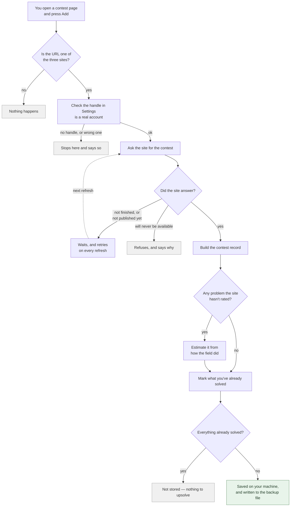
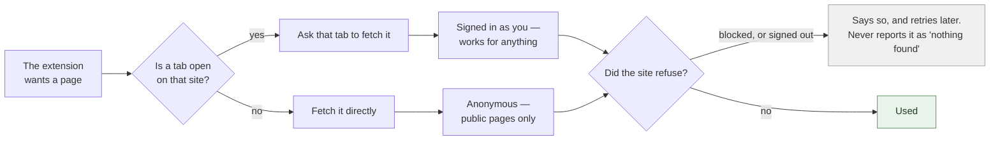

# Where the data comes from

A map of every number in the panel: which site it came from, what was done to it, and where
it ended up. Written so that when something looks wrong you can check it yourself.

There is **no server**. Everything is fetched from the three sites directly by your browser
and stored on your machine.

**Nothing else is fetched at all.** No CDNs, no analytics, no web fonts pulled at runtime.
The two typefaces (Inter and JetBrains Mono) ship inside the extension, every platform mark
is inline SVG, and the only remote addresses in the build are the data APIs listed below.

---

## The short version

| What you see | Where it comes from |
|:--|:--|
| Problem names and IDs | The contest page or API of the site it belongs to |
| Difficulty (the number beside the mark) | Published by the site, except where Codeforces hasn't rated it — those are **estimated** and shown with a dotted underline |
| The `~72%` chance | Calculated locally from that difficulty and your rating on that site |
| Your rating | Fetched from each site when the identity is verified |
| Whether you solved something | Your submission history on that site |
| Topic tags | Codeforces and CodeChef publish them; AtCoder does not |

---

## How a contest gets into your queue

Nothing above leaves your machine except the requests to the three sites themselves.

---

## How a request actually reaches a site

This one matters because it explains a failure you may hit.

**Why the tab matters.** A request made by the extension on its own is treated by the browser
as coming from a *different site*, so your cookies are not attached and the site sees a
stranger. A request made from inside a tab you already have open is treated as coming from
you, cookies and all. So anything needing a login — a private Codeforces gym, your AtCoder
submissions — works when that site is open in a tab, and falls back to public-only access when
it is not.

---

## Codeforces

Two channels are needed, because neither alone is enough.

### The API (`codeforces.com/api/…`)

Signed with your key and secret. Seven methods, each for one job:

| Method | Used for |
|:--|:--|
| `user.info` | Verifying your handle, and reading your rating |
| `user.status` | Your accepted submissions — this is what clears problems from the queue |
| `problemset.problems` | Official difficulties and tags, all ~11k problems in one request — and the check for whether a contest has been published at all |
| `contest.list` | When a contest started, so the Contests tab can sort by date |
| `contest.ratingChanges` | Everyone's rating *before* a contest, used to estimate difficulty |
| `contest.standings` | Gym participants and their ratings, plus gym problem tags **and difficulties** |
| `contest.status` | Every submission to a gym whose standings are hidden — see below |

### The standings page (scraped)

`codeforces.com/contest/<id>/standings` is fetched as HTML and parsed. It is normally the
only source for problem names, problem URLs, and how many people solved each problem
*during* the contest. The API's `solvedCount` counts practice solves too, which is no good
for estimating difficulty.

All the HTML parsing lives in **one file**, `core/platforms/codeforces/standings-dom.js`. If Codeforces
changes its layout, that's the only place to look.

> **Why it can be slow.** Reading standings costs one request per 50 competitors, so a big
> round would be hundreds of requests. Instead ~32 pages are sampled: the top 10 in full
> (they're what decide the hard problems) plus 20 spread evenly through the rest.

### Estimated difficulty

Codeforces rates only *some* gym problems. For those it doesn't, difficulty is
**calculated, not fetched**: given everyone who competed and how many solved a problem,
there's exactly one rating at which the Elo model predicts that many solves, and the code
searches for it.

**Official rounds are no longer estimated.** An official contest is only added once it
appears in `problemset.problems`, which is where Codeforces publishes problems — and it
publishes them already rated, so being listed and being rated arrive together. Until then
the contest waits and is retried on every refresh. Estimating instead would put a number
about 100 points off into your queue and silently swap it later; waiting costs a little
time and nothing else. Estimation on an official round now only happens for the handful of
problems Codeforces lists but never rates.

Each problem records which it was — `ratingSource: "official"` or `"estimated"` — and an
estimate is replaced by the real number as soon as Codeforces publishes one. **In the panel,
an estimated difficulty is underlined with a dotted line**; hover it for the reason.

> **Gyms are not all unrated.** About a third of gym problems carry Codeforces' own published
> difficulty — those are the ones a setter picked from the archive rather than writing
> themselves, so Codeforces still recognises them. That number arrives on the same response
> the tags do, and is preferred over an estimate. The other two thirds are problems written
> for that contest, and those are estimated.

> **How good the estimates are.** On a full official round the model is excellent: it
> reproduces 14 of 15 published ratings exactly. On a gym it is being asked to fit 5–76
> people instead of thousands, and it shows — measured against the gym problems Codeforces
> *does* rate, the estimates were a mean 211 off, with 14 of 62 out by 400 or more. Not
> biased in either direction (mean signed error −10), just noisy. Seven ways of improving it
> were tried and measured; all were neutral or worse. See
> `tests/estimator-accuracy.test.js`, which lists them so they aren't retried.

### When a gym's standings are hidden

A setter can hide a gym's standings. When they do, the standings page has no table *and* the
`contest.standings` API refuses — so both usual sources vanish at once, and adding the
contest used to fail outright.

`contest.status` still answers. One request returns every submission, which between them
carry the problems, their difficulties, who competed, and what they solved. The problem
*list* comes from the ordinary `codeforces.com/gym/<id>` page instead, because a problem
nobody attempted appears in no submission and would silently go missing from your queue.

---

## AtCoder

Everything comes from AtCoder itself. Difficulty is estimated here, because **AtCoder
publishes none at all**.

| Source | Used for | Needs you signed in? |
|:--|:--|:--|
| `atcoder.jp/contests/<id>/tasks` | Contest name, start time, the problem list | no |
| `atcoder.jp/contests/<id>/submissions?f.User=…` | Your submissions, so solved problems clear | **yes** |
| `atcoder.jp/contests/<id>/standings/json` | The field the difficulty is estimated from | **yes** |
| `atcoder.jp/users/<handle>` | Verifying your handle and reading your rating | no |

This used to come from **AtCoder Problems** (kenkoooo), a third-party project, which is no
longer used at all.

Things worth knowing:

- **Difficulty is an estimate, and always was.** AtCoder publishes no rating for its problems.
  The number you see is fitted from how the contest's field actually did — the rating at which
  a competitor had a 50-50 chance. It is shown with a dotted underline, like any estimate.
- **Difficulty can be negative.** 931 problems are below zero — ABC 471's A is −817. That's
  real, not a bug.
- **A problem is identified by its task id**, not its position, so solving one clears it from
  every contest that reuses it — and 1,906 of 9,383 problems appear in more than one.
- **Solved status is read per contest**, because AtCoder publishes no per-user submission
  list. One consequence: solving a problem through a contest you *don't* track won't clear it
  from one you do.
- **Keep an atcoder.jp tab open when refreshing.** Two of the four sources above need your
  session; see the request diagram above.

---

## CodeChef

CodeChef's public API was retired, so the extension uses the same `/api/` endpoints the site's
own front end calls, and only ever for things you're already tracking.

| Endpoint | Used for |
|:--|:--|
| `/api/contests/<code>` | Contest name, its problem list, divisions |
| `/api/contests/<code>/problems/<code>` | Difficulty and tags — one request per problem |
| `/api/list/problems?group=attempted` | **Every problem you've attempted**, which is how solves clear |
| `/dashboard` | Reading which account is signed in |

### When a CodeChef contest isn't ready

Two cases, and neither adds the contest:

- **It's still running.** The payload lists the problems during a contest, so nothing used to
  stop an add mid-flight — which would have recorded in-contest results as if they were final.
  CodeChef reports its own clock beside the contest's end time, so this is decided by *its*
  time, not your computer's.
- **A problem's details couldn't be fetched.** Difficulty costs one request per problem, and if
  one of them fails the contest waits and retries rather than storing that problem as unrated.
  A failed request is not evidence that CodeChef has no rating for it — conflating the two
  showed `???` for problems CodeChef *had* rated.

### Why solved status works differently here

A CodeChef contest stops accepting submissions when it ends, so upsolving happens in
**practice mode** — and the contest's own stats never see it. Reading those stats meant a
CodeChef problem solved after its contest stayed in the queue forever.

So solved status is read from your *attempted problems* list instead, keeping the ones
CodeChef marks Accepted (`status: 1`). Partially-correct answers (`status: 2`) don't count —
scoring some subtasks isn't finishing the problem.

That list is only ever fetched scoped to your own account, and there's a hard cap on how much
of it will be paged. If CodeChef ever stops applying the filter, the sync refuses rather than
walking the whole 21,000-problem catalogue.

### Divisions

`/START252` is a parent contest with no problems of its own. Your rating picks the division
you competed in, so it's stored as e.g. `START252D`. The same problem often runs in all four
divisions, so solving it in one clears it everywhere.

---

## Whose data is it?

**Every site needs a handle, and nothing user-specific is read before that handle is
verified.** Otherwise a contest would be stored unmarked and never clear, looking like a slow
sync rather than a misconfiguration.

The check differs by site, and the difference matters:

- **CodeChef answers for whoever is signed in**, so the signed-in account is compared against
  your configured handle. A mismatch stops the sync — otherwise someone else's solves would be
  written onto your queue, permanently.
- **Codeforces is asked *about* a handle**, so who's signed in there is irrelevant. What's
  verified is that the handle **exists** — not that it's yours. Type someone else's and you'll
  sync their solves; Codeforces offers no way to check.
- **AtCoder is checked both ways.** The handle must exist, and if you're signed in to AtCoder
  it must match the account you're signed in as. It only objects when it can *prove* a
  mismatch: signed out, it falls back to checking the handle exists, because adding a contest
  has to keep working without a session.

If a handle changes, that site's solved flags are cleared so the next sync re-derives them
against the new account.

---

## What's stored, and where

**`chrome.storage.local`** — this is what Export dumps:

| Key | Contents |
|:--|:--|
| `trackedContests` | Your entire queue: every contest, its problems, difficulties, tags, solved flags |
| `upsolve_tracker.handle` / `.atcoder_handle` / `.codechef_handle` | Your handles |
| `upsolve_tracker.platform_ratings` | Your rating on each site |
| `upsolve_tracker.platform_identity` | Which account each site's solved flags belong to |
| `upsolve_tracker.waiting_contests` | Contests you asked for that the site hasn't published yet, retried on every refresh |
| `upsolve_tracker.auto_export` | Whether the backup file is kept current |
| `upsolve_tracker.platform_filter`, `.stats_scope`, `.expanded_contests`, `.waiting_expanded`, `.tag_rating_range.*` | UI state that should survive switching tabs |

**IndexedDB** (`upsolve_tracker_db`) — deliberately separate, because it must **not** appear
in an exported backup:

- your Codeforces API key and secret
- the folder handle for auto-export (this one can't be recreated from a backup — if it's
  lost, just pick the folder again)

---

## If something looks wrong

| Symptom | What to check |
|:--|:--|
| A solved problem won't leave the queue | Is the handle for that site right? Settings shows the account it resolved to. On CodeChef, are you signed in as that account? |
| Nothing syncs at all for one site | The refresh reports per-site failures at the end. A site being down or a handle being wrong fails that site alone; the others still sync. |
| A rating shows `???` | The site published the contest but says that problem has no rating, and that site has no estimator. It's rare: in practice difficulties arrive with the problem list. A problem the extension merely *failed to fetch* never shows `???` — that contest waits instead. |
| A Codeforces difficulty looks off | If it's underlined with a dotted line it's an estimate, not a published number — which on an official round means Codeforces lists the problem but never rated it. On gyms estimates are noisy in both directions, a mean 211 out and occasionally 400+, because the model has only the handful of people who entered to work from. |
| The chance column shows `—` | Either the problem has no difficulty, or your rating for that site is unknown. Those are different problems and the queue shows them differently on purpose. |
| Adding a contest is slow | Expected. Requests are spaced deliberately; a CodeChef division costs about one request per problem. |
| A contest sits in "Waiting" | It isn't ready: still running, or the site hasn't published its problems and difficulties. Every refresh retries it. Codeforces rounds wait for real ratings rather than being added with estimates. |
| CodeChef says "refused the request" | Open codechef.com in a tab and make sure you're signed in. |
| The backup file has stopped updating | The export folder handle lives in IndexedDB and can be lost. Re-pick the folder in Settings. |

The refresh reports failures **last**, after writing the backup, so a message about a failed
sync can't be overwritten by the backup notice.

---

## For the curious

`CLAUDE.md` in this repo is the engineering-side document: why things are built the way they
are, which approaches were tried and rejected, and which invariants must not be broken. It's
considerably more detailed than this file, and considerably more opinionated.
