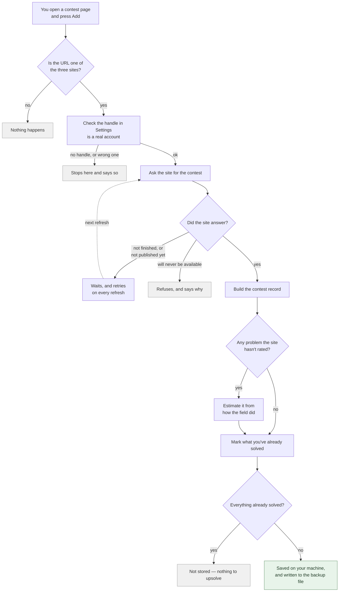
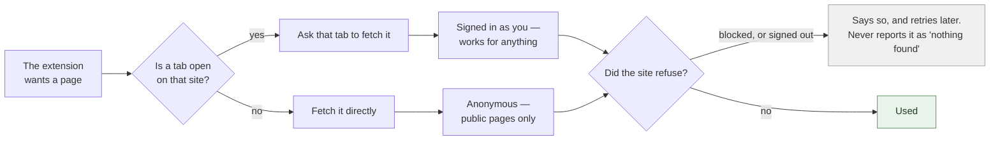

# Where the data comes from

A map of every number in the panel: which site it came from, what was done to it, and where
it ended up. Written so that when something looks wrong you can check it yourself.

There is **no server**. Everything is fetched from the three sites directly by your browser
and stored on your machine.

**Nothing else is fetched at all.** No CDNs, no analytics, no web fonts pulled at runtime.
The two typefaces (Inter and JetBrains Mono) ship inside the extension, every platform mark
is inline SVG, and the only remote addresses in the build are the data APIs listed below.

---

## The short version

| What you see | Where it comes from |
|:--|:--|
| Problem names and IDs | The contest page or API of the site it belongs to |
| Difficulty (the number beside the mark) | Published by the site, except where Codeforces hasn't rated it — those are **estimated** and shown with a dotted underline |
| The `~72%` chance | Calculated locally from that difficulty and your rating on that site |
| Your rating | Fetched from each site when the identity is verified |
| Whether you solved something | Your submission history on that site |
| Topic tags | Codeforces and CodeChef publish them; AtCoder does not |

---

## How a contest gets into your queue

Nothing above leaves your machine except the requests to the three sites themselves.

---

## How a request actually reaches a site

This one matters because it explains a failure you may hit.

**Why the tab matters.** A request made by the extension on its own is treated by the browser
as coming from a *different site*, so your cookies are not attached and the site sees a
stranger. A request made from inside a tab you already have open is treated as coming from
you, cookies and all. So anything needing a login — a private Codeforces gym, your AtCoder
submissions — works when that site is open in a tab, and falls back to public-only access when
it is not.

---

## Every source, at a glance

Where each kind of data comes from, and what happens when that source fails. This is the
*where*; `CLAUDE.md` holds the *why*.

| | Problems | Difficulty | Submissions |
|:--|:--|:--|:--|
| **Codeforces Official** `/contest/<id>` | `contest.standings`  *Not published yet:* waits, and retries on every refresh | `contest.standings`  *Not yet rated by Codeforces:* stored as an estimate, then re-asked from the same endpoint at most weekly — and not at all once the round is six weeks old  *Never rated:* estimated here. Solve counts from the same standings rows; the field from `contest.ratingChanges`, or ~1,500 sampled rows resolved through `user.info` when that is empty | `user.status` — one call, whole history |
| **Codeforces Gyms** `/gym/<id>` | `contest.standings`, signed  *Standings hidden:* scraped from the `/gym/<id>` page — a problem nobody attempted is in no submission, so the list cannot be rebuilt from those | `contest.standings` — about a third of gym problems carry Codeforces' own rating  *The rest:* estimated here. Solve counts and field both from `contest.standings`; when the standings are hidden, from `contest.status` + `user.info` instead  *Field not visible at all:* refuses to add | `user.status` — the same call as official |
| **AtCoder** | Scraped from `/contests/<id>/tasks`  *Unreadable:* waits and retries every refresh | **Always estimated here** — AtCoder publishes no difficulty. Fitted from `/contests/<id>/standings/json` 🔒  *Unreadable:* waits and retries, rather than storing `???` a tab would have filled | Scraped from `/contests/<id>/submissions?f.User=…&f.Status=AC` 🔒  Once per tracked contest |
| **CodeChef** | `/api/contests/<code>`, then `/api/contests/<code>/problems/<code>` — one request per problem  *Parent contest:* resolves to the division matching your rating; with no known rating it names the divisions rather than guessing | `difficulty_rating`, from that same per-problem call  *`-1` or `9999`:* stored as `???` | `/api/list/problems?group=attempted`, paged |

🔒 **needs you signed in to that site.** See the request diagram above: without a tab open
on that site the request goes out anonymously, and these two refuse rather than returning
an empty answer.

### Everything else that gets fetched

| | Also fetched |
|:--|:--|
| **Codeforces** *both platforms* | `problemset.problems` — whether a contest has been published at all, which is the only thing it is used for `user.info` — verifying your handle, and reading your rating `contest.list` — when a contest started, so the Contests tab can sort by date. Official and gyms are separate lists, one call each  Official and gyms are two platforms sharing one account, so each of these runs **twice** per refresh — including `user.status`, which has to, since the response carries no marker saying which kind a submission belongs to |
| **AtCoder** | `/users/<handle>` — verifying your handle, reading your rating, and checking it matches the account you're signed in as Contest name and start time come from the same `/tasks` page as the problems |
| **CodeChef** | `/dashboard` — which account is signed in, which is what your configured handle is checked against Contest name and divisions come from `/api/contests/<code>` |

**Nothing here fails silently.** Every "unreadable" above surfaces as a message or a `???`
— never as an empty result. A blank would be indistinguishable from having genuinely solved
nothing, and solved status is only ever set, never cleared, so a swallowed failure would
strand the queue permanently.

---

## Behaviour worth knowing

Things that surprise people, with no bearing on where the data comes from.

**Codeforces**

- Both official rounds and ordinary gyms are read entirely from the JSON API, so nothing
  there can be blocked by Cloudflare and **no codeforces.com tab needs to be open**. The one
  exception is a gym whose standings the setter hid: that reads a page, and does need a tab.
- A difficulty the extension worked out itself is **underlined with a dotted line**; hover
  it for the reason. On an official round it is close — a mean 100 out, and it leans about 70
  points *low*. On a gym it is fitting 5–76 people instead of thousands and runs a mean 211
  out, occasionally 400+, so treat those as approximate.
- About a third of gym problems carry Codeforces' own published difficulty — the ones a
  setter took from the archive rather than writing. Those are not estimates.
- A gym whose standings the setter hid still works; it is rebuilt from the submissions.

**AtCoder**

- **Keep an atcoder.jp tab open when refreshing.** Both rows marked 🔒 need your session,
  and without a tab the request goes out anonymously and is refused.
- Every difficulty here is an estimate — AtCoder publishes none — and it can be **negative**.
  ABC 471's A is −817. That is real.
- You will never see `???` on AtCoder. If the standings can't be read, the contest waits for
  a refresh with a tab open rather than filling the queue with blanks.
- A problem is identified by its task id, not its position, so solving it clears it from
  every contest that reuses it. 1,906 of 9,383 problems appear in more than one.
- Solved status is read per contest, so solving something through a contest you *don't*
  track will not clear it from one you do.

**CodeChef**

- `/START252` is a parent contest; your rating picks the division you competed in, and it is
  stored as e.g. `START252D`. The same problem usually runs in all four, so solving it once
  clears it everywhere.
- A partially-correct answer is not a solve. Scoring some subtasks is not finishing it.
- Upsolving happens in practice mode, so solved status is read from your attempted-problems
  list rather than from the contest's own stats.
- A few older problems were never mirrored to practice and can no longer be submitted. Those
  stay in the contest, greyed with a ⚠, and are left out of the queue.

---

## Whose data is it?

**Every site needs a handle, and nothing user-specific is read before that handle is
verified.** Otherwise a contest would be stored unmarked and never clear, looking like a slow
sync rather than a misconfiguration.

The check differs by site, and the difference matters:

- **CodeChef answers for whoever is signed in**, so the signed-in account is compared against
  your configured handle. A mismatch stops the sync — otherwise someone else's solves would be
  written onto your queue, permanently.
- **Codeforces is asked *about* a handle**, so who's signed in there is irrelevant. What's
  verified is that the handle **exists** — not that it's yours. Type someone else's and you'll
  sync their solves; Codeforces offers no way to check.
- **AtCoder is checked both ways.** The handle must exist, and if you're signed in to AtCoder
  it must match the account you're signed in as. It only objects when it can *prove* a
  mismatch: signed out, it falls back to checking the handle exists, because adding a contest
  has to keep working without a session.

If a handle changes, that site's solved flags are cleared so the next sync re-derives them
against the new account.

---

## What's stored, and where

**`chrome.storage.local`** — this is what Export dumps:

| Key | Contents |
|:--|:--|
| `trackedContests` | Your entire queue: every contest, its problems, difficulties, tags, solved flags |
| `upsolve_tracker.handle` / `.atcoder_handle` / `.codechef_handle` | Your handles |
| `upsolve_tracker.platform_ratings` | Your rating on each site |
| `upsolve_tracker.platform_identity` | Which account each site's solved flags belong to |
| `upsolve_tracker.waiting_contests` | Contests you asked for that the site hasn't published yet, retried on every refresh |
| `upsolve_tracker.auto_export` | Whether the backup file is kept current |
| `upsolve_tracker.platform_filter`, `.stats_scope`, `.expanded_contests`, `.waiting_expanded`, `.tag_rating_range.*` | UI state that should survive switching tabs |

**IndexedDB** (`upsolve_tracker_db`) — deliberately separate, because it must **not** appear
in an exported backup:

- your Codeforces API key and secret
- the folder handle for auto-export (this one can't be recreated from a backup — if it's
  lost, just pick the folder again)

---

## If something looks wrong

| Symptom | What to check |
|:--|:--|
| A solved problem won't leave the queue | Is the handle for that site right? Settings shows the account it resolved to. On CodeChef, are you signed in as that account? |
| Nothing syncs at all for one site | The refresh reports per-site failures at the end. A site being down or a handle being wrong fails that site alone; the others still sync. |
| A rating shows `???` | Only CodeChef does this. It means CodeChef itself lists the problem as unrated — Codeforces and AtCoder both work a difficulty out instead, so neither ever shows one. A problem the extension merely *failed to fetch* never shows `???` on any site: that contest waits and retries. |
| A Codeforces difficulty looks off | If it's underlined with a dotted line it's an estimate, not a published number — which on an official round means Codeforces lists the problem but never rated it. On gyms estimates are noisy in both directions, a mean 211 out and occasionally 400+, because the model has only the handful of people who entered to work from. |
| The chance column shows `—` | Either the problem has no difficulty, or your rating for that site is unknown. Those are different problems and the queue shows them differently on purpose. |
| Adding a contest is slow | Expected. Requests are spaced deliberately; a CodeChef division costs about one request per problem. |
| A contest sits in "Waiting" | It isn't ready: still running, or the site hasn't published its problems and difficulties. Every refresh retries it. A Codeforces round waits until Codeforces lists it at all — not until it is rated, since a listed-but-unrated round is added with estimates that settle later. |
| CodeChef says "refused the request" | Open codechef.com in a tab and make sure you're signed in. |
| The backup file has stopped updating | The export folder handle lives in IndexedDB and can be lost. Re-pick the folder in Settings. |

The refresh reports failures **last**, after writing the backup, so a message about a failed
sync can't be overwritten by the backup notice.

---

## For the curious

This file answers **where**. `CLAUDE.md` answers **why** — which alternatives were tried and
measured, what each source cannot do, and which invariants must not be broken. It is the
longer and far more opinionated of the two, and it is where any reasoning that used to be
duplicated here now lives.

If the two ever disagree about a source, this file is wrong until proven otherwise: it is the
one meant to be checkable against the panel in front of you.
